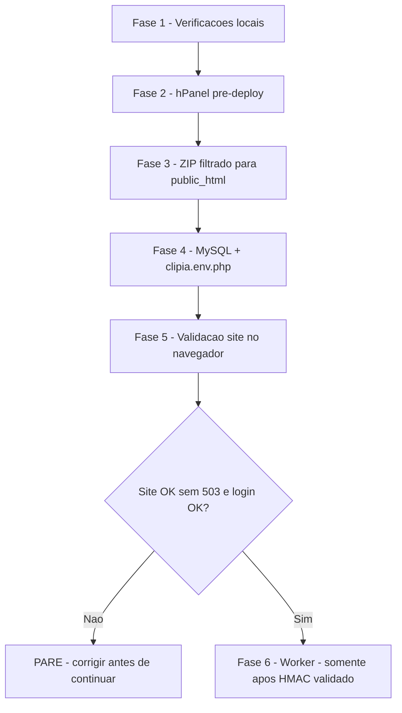

# Preparação e publicação ClipIA na Hostinger (manual)

**Objetivo:** sequência objetiva para publicar o PHP na Hostinger **sem** expor worker, segredos ou dados de demonstração.  
**Este documento não prova que a produção está OK** — registre resultados em [`CHECKLIST_VALIDACAO_PRODUCAO.md`](CHECKLIST_VALIDACAO_PRODUCAO.md).

| Item | Valor |
|------|--------|
| App pública | `public_html/clipia/` |
| Caminho absoluto app | `/home/u586160337/domains/sthevandev.com.br/public_html/clipia/` |
| Config privada | `/home/u586160337/domains/sthevandev.com.br/private/clipia.env.php` |
| Site | https://clipia.sthevandev.com.br/ |

**Guia detalhado hPanel:** [`GUIA_PUBLICACAO_MANUAL.md`](GUIA_PUBLICACAO_MANUAL.md)  
**Referências:** [`HOSTINGER.md`](HOSTINGER.md) (detalhes) · [`WORKER_WINDOWS.md`](WORKER_WINDOWS.md) (worker **depois** da validação)

---

## Visão geral (ordem obrigatória)



**Regra:** **não** execute `python main.py --process-next`, `--poll`, upload de jobs reais nem habilite `CLIPIA_ALLOW_PAID_API` até a **Fase 5** estar concluída **e** a paridade HMAC servidor ↔ PC confirmada (comprimento do segredo, não o valor).

---

## Fase 1 — Verificações locais (PC, offline)

Execute na raiz do projeto:

```powershell
Set-Location C:\Users\Administrador\OneDrive\Desktop\projeto_clips
.\deploy\verify-local.ps1
```

| # | Critério | Esperado |
|---|----------|----------|
| 1.1 | Exit code do script | `0` |
| 1.2 | Sintaxe PHP (`php -l`) | Sem erros em `app.php`, `clipia_env_loader.php`, `database.php`, `worker-api.php` |
| 1.3 | Worker offline | `hmac_ready=True`, `allow_paid_api=False` |
| 1.4 | Testes | HMAC 7/7, security 6/6 |

Gere o pacote (ainda **não** envie ao servidor):

```powershell
.\deploy\build-hostinger-package.ps1
```

| # | Critério | Esperado |
|---|----------|----------|
| 1.5 | Arquivo gerado | `deploy\clipia-hostinger-public.zip` |
| 1.6 | Conteúdo | **47** entradas; inclui `pages/worker-api.php`, `config/schema.sql`, `LEIA-ME-HOSTINGER.txt` |
| 1.7 | Ausente no ZIP | `worker_service/`, `.env`, `env.production.php`, `env.local.php`, `env.*.example.php`, mídia/logs/audit em `storage/` |

**Se Fase 1 falhar:** corrija o ambiente local (PHP, Python, deps) antes de abrir o hPanel. **Não publique.**

---

## Fase 2 — Verificações no hPanel (antes do upload)

Faça **no painel Hostinger**, sem depender do Auto Deploy da raiz do Git (recomendado: **ZIP filtrado**).

| # | Ação | Notas |
|---|------|--------|
| 2.1 | PHP **8.2+** | Configuração PHP do domínio/subpasta |
| 2.2 | `display_errors` | **Off** |
| 2.3 | Upload | `upload_max_filesize` e `post_max_size` ≥ 100M (ideal 128M) |
| 2.4 | SSL | Certificado ativo; forçar HTTPS se disponível |
| 2.5 | MySQL | Criar banco + usuário; anotar **nomes** (não colar senhas em chats) |
| 2.6 | Auto Deploy (se existir) | Se **não** usar exclusões comprovadas no Git, **desative** ou **não** dispare deploy da raiz — preferir ZIP |

**Se usar Auto Deploy apesar do risco:** após qualquer push, volte à [Fase 3.2](#fase-3--envio-manual-do-zip-filtrado) e confirme ausência de pastas proibidas.

---

## Fase 3 — Envio manual do ZIP filtrado

### 3.1 Upload

1. Baixe/copie `deploy\clipia-hostinger-public.zip` do PC.
2. No **Gerenciador de Arquivos** ou **FTP/SFTP**, abra `public_html/clipia/` (crie `clipia` se necessário).
3. Envie o ZIP e **extraia** no destino (ou extraia localmente e envie os arquivos).
4. Confirme na raiz de `clipia/`: `index.php`, `.htaccess`, `LEIA-ME-HOSTINGER.txt`.

Leia `LEIA-ME-HOSTINGER.txt` no servidor — resumo autocontido; documentação completa fica no Git (`deploy/PREPARACAO_PUBLICACAO.md`, este arquivo).

### 3.2 Verificação explícita — nada proibido em `public_html/clipia/`

No **Gerenciador de Arquivos**, confirme que **NÃO existem** (pastas ou arquivos):

| Proibido em `public_html/clipia/` | Motivo |
|-------------------------------------|--------|
| `worker_service/` | Worker Python — só no PC |
| Qualquer `.env` | Segredos locais |
| `config/env.production.php` | Config real com credenciais |
| `config/env.local.php` | Config local |
| `config/env.example.php` / `env.production.example.php` | Modelos (ficam no Git, não na web) |
| `storage/samples/` | Mídia de demonstração |
| `storage/audit_*`, `storage/import_audit_demo.php` | Scripts/dados de audit local |
| `storage/clips/*` (exceto `.gitkeep`) | Clipes reais |
| `storage/uploads/*` (exceto `.gitkeep`/`.htaccess`) | Uploads de usuários |
| `storage/logs/*.log` | Logs |
| `deploy/` (scripts, ZIP) | Ferramentas de build |
| Artefatos `tinger*` | Lixo acidental (não deve ir ao servidor) |

**Deve existir:**

- `pages/worker-api.php` (API M2M — protegida por HMAC, não por ocultação)
- `storage/uploads/`, `storage/clips/`, `storage/logs/` com `.gitkeep` e `.htaccess` conforme o pacote

| # | Resultado |
|---|-----------|
| 3.2 | ☐ Nenhum item proibido encontrado |

**Se encontrar `worker_service/` ou `.env` em `public_html/clipia/`:** **PARE.** Remova esses itens do servidor antes de MySQL/env/login. Não prossiga para worker.

---

## Fase 4 — Configuração privada e MySQL

Ordem sugerida: **MySQL primeiro**, depois **`clipia.env.php`**, para evitar 503 prolongado sem banco.

### 4.1 MySQL (phpMyAdmin)

1. Selecione o banco correto.
2. Importe **`config/schema.sql`** (do pacote em `public_html/clipia/config/schema.sql`).
3. Valide **8 tabelas** — consulta em [`CHECKLIST_VALIDACAO_PRODUCAO.md`](CHECKLIST_VALIDACAO_PRODUCAO.md) seção C.

### 4.2 Arquivo privado

1. Crie `/home/u586160337/domains/sthevandev.com.br/private/` (permissão **700**).
2. Crie **`clipia.env.php`** (permissão **600**) — **fora** de `public_html`.
3. Monte o array PHP a partir do modelo **`config/env.production.example.php` no repositório Git** (não suba esse arquivo para `public_html`).

Chaves mínimas (nomes apenas; preencha valores **no servidor**):

- `APP_ENV`, `APP_URL`, `DB_*`, `WORKER_SHARED_SECRET` (≥16 caracteres), `WORKER_REQUIRE_HTTPS`
- Se `users` vazia: `ADMIN_OWNER_EMAIL`, `ADMIN_OWNER_PASSWORD_HASH`

Detalhes: [`HOSTINGER.md`](HOSTINGER.md) §§ 2–6.

| # | Resultado |
|---|-----------|
| 4.1 | ☐ `schema.sql` importado; 8 tabelas |
| 4.2 | ☐ `private/clipia.env.php` existe com permissões corretas |

**Não** copie `WORKER_SHARED_SECRET` para o `worker_service/.env` até a Fase 5 OK (pode preparar o valor no servidor e no PC, mas **não** dispare jobs).

---

## Fase 5 — Validação do site (após envio + env + MySQL)

Use o **navegador** (você executa; este doc não substitui o teste).

| # | Teste | Esperado |
|---|--------|----------|
| 5.1 | https://clipia.sthevandev.com.br/ | **Sem** página “Configuração do servidor incompleta” (HTTP 503) |
| 5.2 | `/login.php` | Formulário carrega; **sem** mensagem de erro de banco na tela |
| 5.3 | Login com credenciais que **você** definiu | Redireciona ao dashboard |
| 5.4 | `/register.php` | Cadastro público bloqueado |
| 5.5 | Gerenciador | Ainda **sem** `worker_service/` em `public_html/clipia/` |

Registre colunas **Resultado** em [`CHECKLIST_VALIDACAO_PRODUCAO.md`](CHECKLIST_VALIDACAO_PRODUCAO.md) seções **D.3–D.7**.

### Paridade HMAC (pré-requisito da Fase 6)

- No servidor: confirme que `WORKER_SHARED_SECRET` tem o comprimento esperado (ex.: 64 hex — **conte caracteres, não copie o valor**).
- No PC: após atualizar `CLIPIA_WORKER_SHARED_SECRET` no `.env` local, rode `.\deploy\verify-local.ps1` → `hmac_secret_length` com **mesmo comprimento**.

**Validação real da API** (POST autenticado à `worker-api.php`) só após autorização explícita — ver [`HOSTINGER.md`](HOSTINGER.md) §10.

---

## Fase 6 — Worker (posterior; só após Fase 5 + HMAC)

**Pré-condições:** D.3–D.7 do checklist **OK**; site sem 503; login OK; comprimento HMAC igual PC/servidor; autorização explícita para smoke.

1. Configure `worker_service/.env` no Windows — [`WORKER_WINDOWS.md`](WORKER_WINDOWS.md).
2. Mantenha `CLIPIA_ALLOW_PAID_API=false`.
3. Primeiro teste: **uma** execução controlada (`python main.py --process-next`) com upload pequeno autorizado — **não** use `--poll` contínuo na primeira vez.

**Se worker retornar 401/403/503 na API:** **PARE** o processamento; não reenvie jobs em loop. Corrija HMAC, HTTPS ou relógio — tabela em [`HOSTINGER.md`](HOSTINGER.md) §9.

---

## Quando PARAR e não continuar

Interrompa o procedimento **antes** de worker/jobs se ocorrer:

| Sintoma | Fase | Ação imediata |
|---------|------|----------------|
| `verify-local.ps1` exit ≠ 0 | 1 | Corrigir PC; não subir ZIP |
| ZIP ≠ 47 entradas ou contém `worker_service` | 1 | Regenerar com `build-hostinger-package.ps1`; inspecionar de novo |
| `worker_service/`, `.env` ou demo em `public_html/clipia/` | 3 | Remover do servidor; revisar método de upload |
| HTTP **503** “Configuração incompleta” | 5 | Revisar `private/clipia.env.php` (caminho, permissões, chaves); ver `storage/logs/php_errors.log` **no servidor** (sem colar segredos) |
| Login com erro de **banco** / PDO | 5 | Revisar `DB_HOST`, `DB_NAME`, `DB_USER`, `DB_PASS` no hPanel e no env privado |
| Login falha sem erro de banco | 5 | Verificar `users`, `ADMIN_OWNER_*`, hash bcrypt |
| SSL/HTTPS inválido | 5 | Corrigir certificado antes de worker (`WORKER_REQUIRE_HTTPS`) |
| HMAC com comprimento diferente PC vs servidor | 5–6 | **Não** iniciar worker; igualar segredo nos dois lados |

**Não** “contornar” 503 publicando segredos em `public_html/clipia/config/`.

---

## Resumo: quem faz o quê

| Onde | O quê |
|------|--------|
| PC | `verify-local.ps1`, `build-hostinger-package.ps1`, inspeção ZIP, modelo env no Git |
| hPanel / FTP | PHP, MySQL, upload ZIP, `private/clipia.env.php`, auditoria de pastas proibidas |
| Navegador | 503, login, registro bloqueado |
| PC (depois) | Worker + smoke job **somente** após checklist OK |

---

**Status:** guia de preparação; **produção não validada** até você preencher o checklist com evidências próprias.
